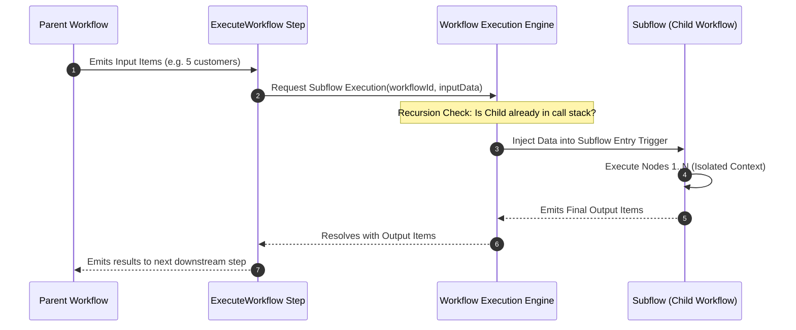

# 07. Subflow & Modular Flow Architecture — Deep Technical Blueprint

> **Target Platform:** KaivoFlow (Android Local-First Automation Engine)  
> **Language:** Hinglish (Senior Architect Deep-Dive)  
> **Topic:** Subflows (Sub-workflows) kaise design hote hain, parent-child data isolation, execution stack, recursion guard aur cross-flow return items.

---

## 1. Kyun Zaroori Hai Subflows? (The Problem Statement)

Jab koi user real-world automation banata hai (e.g. *"Ek complex CRM lead scoring system jo 20 steps ka hai"*):
- Agar subflow na ho:
  - Ek hi canvas par 50 nodes ka jhanjhat ban jata hai (spaghetti workflow).
  - Code ya logic reuse nahi ho sakta. Agar dusra flow bhi lead score karna chahe, toh 20 nodes duplicate copy-paste karne padte hain.
  - Test karna mushkil ho jata hai.
- **Subflow Solution:**
  - Lead Scoring ko ek independent subflow bana do: `Subflow: Score Leads`.
  - Main workflow sirf ek single Step lagata hai: `Execute Workflow` $\rightarrow$ Target: `Score Leads`.
  - Data pass hota hai, subflow execute hota hai, aur output clean JSON me wapas parent workflow ko milta hai!

---

## 2. Reference System (`ExecuteWorkflow`) Architecture Analysis

Reference system (`packages/nodes-base/nodes/ExecuteWorkflow`, `packages/workflow/src/sub-workflow-output.ts`) mein subflow ka architecture 4 pillars par chalta hai:



### Pillar 1: Subflow Entry Point (`WorkflowTrigger` vs `WorkflowInputs`)
- Subflow ka starting trigger hota hai: **`WorkflowTrigger`** (ya `ExecuteWorkflowTrigger`).
- Is trigger me do modes hote hain:
  1. `Accept all data`: Parent flow ka jo bhi JSON aaya, woh as-it-is first step ko mil jaye.
  2. `Declared Schema (Workflow Inputs)`: Subflow strictly define karta hai ki mujhe kya chahiye:
     - `customerName` (String, Required)
     - `creditScore` (Number, Required)
     - `email` (String, Optional)
  - Agar parent flow ne galat type ya missing field bheji, toh engine run time par error de deta hai: *"Subflow expected customerName but got undefined"*.

### Pillar 2: Subflow Parameter Mapper (`ResourceMapper`)
- Parent workflow ke `ExecuteWorkflow` step me **Resource Mapper** UI hota hai:
  - User choose karta hai: `Workflow: Score Leads`.
  - Step automatically child workflow ka declared schema inspect karta hai aur UI me parameter input fields generate karta hai!
  - User direct expressions bind kar sakta hai:
    - `customerName` $\leftarrow$ `{{ $json.name }}`
    - `creditScore` $\leftarrow$ `{{ $json.score }}`

### Pillar 3: Data Isolation & Call Stack Memory
- Subflow ka execution parent se completely isolated hota hai:
  - Parent ke internal variable changes child me leak nahi hote.
  - Child ke temporary variables parent ko corrupt nahi karte.
  - Child ka execution history database me apna separate `executionId` maintain karta hai with parent pointer (`parentExecutionId`).

### Pillar 4: Recursion & Infinite Loop Protection
- Agar Flow A calls Flow B, aur Flow B calls Flow A $\rightarrow$ system crash ya out of memory ho sakta hai!
- Reference engine ek **Call Stack Tracker** maintain karta hai:
  ```ts
  const callStack: string[] = ['flowA_id'];
  if (callStack.includes(targetFlowId)) {
    throw new NodeOperationError(
      this.getNode(),
      `Recursion detected! Workflow ${targetFlowId} is already in the call stack: ${callStack.join(' -> ')}`
    );
  }
  ```
- Max depth limit (default 10) enforce hoti hai.

---

## 3. KaivoFlow Ke Liye Step-by-Step Implementation Blueprint

Kal KaivoFlow mein subflow feature implement karne ke liye hume yeh 4 components banane hain:

### A. Subflow Trigger Step: `workflow.trigger` (`:core:nodes`)
```kotlin
data class SubflowInputDef(
    val name: String,
    val type: FieldType, // String, Number, Boolean, JsonObject, Array
    val required: Boolean = true,
    val description: String = "",
)

class SubflowTriggerStep : NodeDefinition {
    override val id = "workflow.trigger"
    override val name = "Workflow Input"
    override val category = NodeCategory.Triggers
    // Declares accepted schema inputs
}
```

### B. Execute Subflow Step: `workflow.execute` (`:core:nodes`)
```kotlin
class ExecuteWorkflowStep @Inject constructor(
    private val flowRepository: FlowRepository,
    private val flowRunner: FlowRunner,
) : StepExecutor {
    suspend fun execute(
        targetFlowId: String,
        inputs: List<EngineItem>,
        callStack: List<String>,
    ): StepExecutionResult {
        // 1. Recursion check
        if (callStack.contains(targetFlowId)) {
            return StepExecutionResult.Failure("Recursion loop detected: ${callStack + targetFlowId}")
        }
        if (callStack.size >= 10) {
            return StepExecutionResult.Failure("Maximum subflow call depth (10) exceeded.")
        }

        // 2. Load child flow
        val childFlow = flowRepository.flow(targetFlowId)
            ?: return StepExecutionResult.Failure("Target Flow $targetFlowId not found")

        // 3. Inject inputs into Trigger
        val childRun = flowRunner.runIsolated(
            flow = childFlow,
            initialData = inputs,
            callStack = callStack + targetFlowId,
        )

        // 4. Return child final step output items to parent flow
        return StepExecutionResult.Success(childRun.finalOutputItems)
    }
}
```

### C. Canvas UI Selector (`:feature:canvas`)
- Node details view me jab `Execute Workflow` open ho:
  - Dropdown: User ke saved workflows ki list dikhaye.
  - "Open Subflow in Canvas" shortcut link taaki user 1-click me child workflow par jump kar sake.
