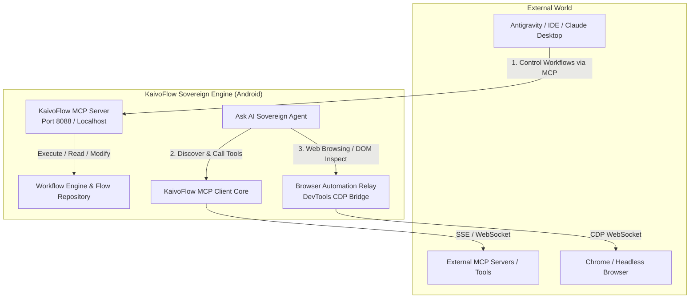

# 08. MCP (Model Context Protocol) & External Connectors Architecture

> **Target Platform:** KaivoFlow (Android Local-First Automation Engine)  
> **Language:** Hinglish (Senior Architect Deep-Dive)  
> **Topic:** Model Context Protocol (MCP) Client & Server Architecture, Browser DevTools Protocol (CDP), External Agent Control (Antigravity/Claude), aur Android Local Inter-App Bridges.

---

## 1. MCP Kya Hai Aur KaivoFlow Ko Iski Kyun Zaroorat Hai?

**Model Context Protocol (MCP)** Anthropic ka open standard hai jo AI models aur external tools/data sources ke beech universal communication establish karta hai.
KaivoFlow ko ek **Million-Dollar Platform** banane ke liye MCP ke **Dono Sides (Client + Server)** implement karne hain:



---

## 2. Side A: KaivoFlow as an MCP Server (External Agents Control KaivoFlow)

Jaise user ne prompt me poocha: *"Bahar ke jese tum Antigravity kaise control kar sakte ho?"*
Jab KaivoFlow apne device par ek lightweight **MCP Server** chalata hai (e.g. `http://localhost:8088/mcp` ya local WebSocket):
Antigravity, Cursor, Claude Desktop ya CLI KaivoFlow se direct baat kar sakte hain standard MCP JSON-RPC protocol ke zariye:

### Exposed MCP Tools by KaivoFlow:
1. `kaivoflow_list_workflows`: Saved workflows ki list aur status return karta hai.
2. `kaivoflow_get_workflow`: Specific workflow ka complete JSON graph return karta hai.
3. `kaivoflow_create_workflow`: External agent (jaise Antigravity) naya workflow generate karke direct KaivoFlow me save kar sakta hai.
4. `kaivoflow_run_workflow`: Input JSON ke sath workflow trigger karta hai aur execution result return karta hai.
5. `kaivoflow_get_execution_logs`: Failed step ka exact error trace aur output snapshot return karta hai.

**Kyun Yeh Game Changer Hai?**
- User apne desktop par baithkar Antigravity ko bol sakta hai:
  *"Hey, trigger my KaivoFlow battery monitor flow on my phone and give me the output."*
- Antigravity standard MCP call karke phone ke KaivoFlow engine ko trigger kar dega!

---

## 3. Side B: KaivoFlow as an MCP Client (Agent Uses External Tools)

Jab KaivoFlow ka **Ask AI Agent** run hota hai, woh external MCP tools connect kar sakta hai:
- Reference system (`@n8n/nodes-langchain/nodes/mcp`):
  - `McpClient`: Connects to an MCP endpoint (via Server-Sent Events - SSE, ya WebSocket).
  - Protocol Lifecycle:
    1. **Handshake (`initialize`)**: Client and Server exchange capabilities and protocol version (`2024-11-05`).
    2. **Tool Discovery (`tools/list`)**: MCP server apne available tools return karta hai with standard JSON Schema parameters:
       ```json
       {
         "tools": [
           {
             "name": "search_database",
             "description": "Searches internal inventory database",
             "inputSchema": { "type": "object", "properties": { "query": { "type": "string" } } }
           }
         ]
       }
       ```
    3. **Tool Invocation (`tools/call`)**: Jab model tool call generate karta hai, client server ko JSON-RPC message bhejta hai:
       ```json
       {
         "method": "tools/call",
         "params": { "name": "search_database", "arguments": { "query": "battery" } }
       }
       ```
    4. **Result Processing**: Result parse hoke wapas agent ke prompt context me return hota hai.

---

## 4. Browser Automation Connector (CDP Relay & Headless WebView)

Reference repo (`@n8n/mcp-browser`) mein browser automation 3 layers par chalta hai:
1. **CDP Relay (`cdp-relay.ts`)**:
   - Chrome DevTools Protocol WebSocket relay.
   - User ke browser me `http://localhost:9222` par connect hota hai.
2. **High-Level Automation Tools**:
   - `browser_navigate`: URL open karta hai.
   - `browser_click`: CSS selector ya text query par tap/click karta hai.
   - `browser_type`: Form fields me text type karta hai.
   - `browser_snapshot`: DOM tree ko concise accessible format me compress karta hai (LLM context window bachane ke liye!).
   - `browser_screenshot`: Page ka visual image le kar vision model ko deta hai.
3. **Sensitive Data Redaction (`redact.ts`)**:
   - DOM tree me se passwords, credit card numbers, auth tokens aur email addresses ko automatically replace karta hai `[REDACTED_SECRET]` se taaki sensitive data LLM API par leak na ho!

### Android Ke Liye Sovereign Adaptation:
- Android par KaivoFlow do options support kar sakta hai:
  - **Option 1 (Headless Android WebView)**: Background me zero-footprint WebView load karo with `WebSettings` and evaluate JavaScript / scrape clean DOM.
  - **Option 2 (Remote Chrome CDP)**: Agar phone me Chrome debugging on hai (`localhost:9222`), direct Chrome ke tabs ko control karo!

---

## 5. Android Local Inter-App Connectors (The Sovereign Bridge)

Server automation platforms (jaise n8n) sirf HTTP/REST APIs se baat kar sakte hain.
Lekin **KaivoFlow Android par hai**, jahan applications aapas mein **IPC (Inter-Process Communication)** se baat karti hain:
1. **Android ContentProviders**: Phone ke SMS, Contacts, Calendar, MediaStore ko zero-API-key bina external server direct SQL query se read/write karna!
2. **BroadcastReceivers & Intents**: Kisi bhi 3rd-party Android app ka Intent trigger karna (e.g. `android.intent.action.VIEW`, `android.intent.action.SEND`).
3. **Accessibility Automation Service**: Agar kisi app ki API nahi hai (jaise WhatsApp, Instagram, banking apps), Accessibility Service ke zariye on-screen buttons auto-click aur type karna!

---

## 6. Action Items (Kal Ka Implementation Scope)

1. **`McpJsonRpcClient` Engine (`:core:network` & `:core:ai`):**
   - Pure Kotlin lightweight MCP client over SSE / HTTP POST.
   - `tools/list` fetcher aur `tools/call` executor.
2. **`BrowserDevToolsRelay` (`:feature:flows:ai`):**
   - Connect dialog jo humne banaya usse bind karke `localhost:9222` CDP endpoint par page snapshot aur navigate call karna.
3. **`KaivoFlowLocalMcpServer` (`:core:network`):**
   - Embedded Ktor HTTP server on `localhost:8088` exposing `run_flow` aur `list_flows` to external agents (Antigravity/Claude).
